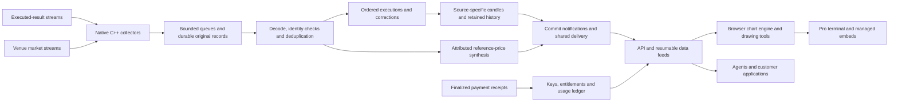

# ticking

**A market address in. A live chart out.**

Ticking turns executed market activity into durable candles, live data feeds and embeddable charts. A developer supplies a market or token address; the same data engine serves an agent, a chart embedded in a product, and the Pro terminal.

[Live product](https://ticking.dev) · [Pro terminal](https://ticking.dev/#/terminal/SOL) · [Developer console](https://ticking.dev/#/console)

This is the selected source release for our Colosseum submission. It contains our collection, processing, delivery, charting and metered-access implementations. The marketing website, console screens, deployment credentials, customer records, historical datasets and bulk historical downloaders are intentionally outside this repository.

## Architecture



### Receive once, serve many

Native collectors share upstream connections across customers. They check frame sizes, stream identity and sequence, keep bounded queues, reconnect with backoff, and record original inputs before downstream publication. CPU work, disk durability and browser rendering have separate responsibilities.

### Preserve what a price means

A market identity includes its source, base/quote units and pool or instrument. Executions are ordered by their source coordinates, not arrival time. Repeated identities must agree; conflicts fail validation. Failed executions do not become candles. Corrections and fork retractions are explicit operations.

Trade-derived candles and reference-price synthesis are separate series. A reference observation never manufactures execution volume. Missing records, carried closes, provisional results and incomplete coverage remain visible in the data contract. Historical readers serve retained records; the private bulk acquisition pipeline is not included.

### Publish changes, not repeated work

The processing path commits data before notifying shared readers. Market-scoped caches and stream hubs reuse work across subscribers. Browser feeds validate identity, apply exact-base deltas, retain the last good frame through a reconnect, and request a fresh snapshot when a cursor or revision cannot be reconciled. Slow clients have bounded buffers.

### Render on the customer's device

The chart engine draws the visible candle range on Canvas2D. Crosshair and drawing work are separated from price rendering. The SDK includes interval handling, paging, correction-aware feeds, indicators, editable drawing geometry, saved layouts and lifecycle cleanup. The Pro terminal combines a market browser, chart tools, execution tape, order-book snapshots, execution profiles and source/coverage inspection.

The production terminal renderer and the independent SDK are both present. They are distinct implementations; worker studies and linked layouts in the independent SDK are not claimed to be active in every terminal view.

### Let agents pay for bounded access

API keys carry scopes; subscriptions grant product entitlements. Explicit prepaid access adds per-read prices, time/bandwidth-metered stream leases, daily budgets, reservations, idempotent result replay and release of unused reservations. A balanced integer-unit ledger credits only verified, invoice-bound finalized receipts. Client agents retain their signing authority; this service does not hold customer wallet keys.

Managed chart projects issue short-lived display grants for registered origins. A backend secret key stays on the customer's server. A newly registered token enters a verified discovery/watch path before data is served; an address alone is not proof of a usable market or complete history.

## Code map

| Component | Source |
| --- | --- |
| Native collectors, execution decoder, event pool and durable journal | [`engine/engine`](engine/engine) |
| Candle projection, reference synthesis, quality checks and retained readers | [`engine`](engine) |
| Shared streams, customer API, scoped display grants and payment accounting | [`api/server`](api/server) |
| Production chart engine, drawing tools and Pro terminal | [`terminal/src`](terminal/src) |
| Browser history/live feeds and managed embeds | [`terminal/sdk`](terminal/sdk) |
| Independent chart SDK, worker studies and layout model | [`packages/chart-sdk`](packages/chart-sdk) |
| Agent integration and a minimal terminal host | [`examples`](examples) |
| Reproducible checks and publication boundary | [`docs/VERIFICATION.md`](docs/VERIFICATION.md), [`docs/PUBLICATION.md`](docs/PUBLICATION.md) |

## Run and review

The native path targets Linux, C++20 and system libraries. Python 3.12+ serves the control/read plane; Node 22+ runs browser-module checks. No production credentials are needed for the offline tests.

```sh
# See docs/BUILD.md for system dependencies and the pinned interface bootstrap.
python3 -m venv .venv
.venv/bin/pip install -r requirements.lock
PATH="$PWD/.venv/bin:$PATH" ./scripts/build-native.sh
./scripts/check.sh

# Minimal Pro host: reads an explicitly selected API; no homepage is included.
python examples/terminal_server.py --api https://api.ticking.dev
# Open http://127.0.0.1:8080/#/terminal/SOL
```

An existing managed project can embed a chart without exposing a secret API key:

```html
<script type="module" src="https://ticking.dev/sdk/managed-embed.js"></script>
<ticking-embed project="YOUR_PUBLIC_PROJECT_ID"
  market="YOUR_MARKET_OR_MINT" interval="1m" tools>
</ticking-embed>
```

See [the API and agent flow](docs/API_AND_AGENTS.md), [build instructions](docs/BUILD.md) and [data contracts](docs/DATA_CONTRACTS.md).

## Scope and current limits

The released collectors consume externally supplied executed results and market streams. They are not consensus clients or independently operated full execution nodes. Supported adapters and observed coverage are finite. Bounded recovery is not a promise of whole-chain completeness, lifetime history, zero downtime or a latency SLA.

This publication preserves the submitted source snapshot and records the adaptations needed to remove private infrastructure and bulk-history jobs. External dependencies, interfaces and the pre-existing SDK license remain attributed in [NOTICE](NOTICE.md). Source visibility does not grant market-data redistribution rights.
