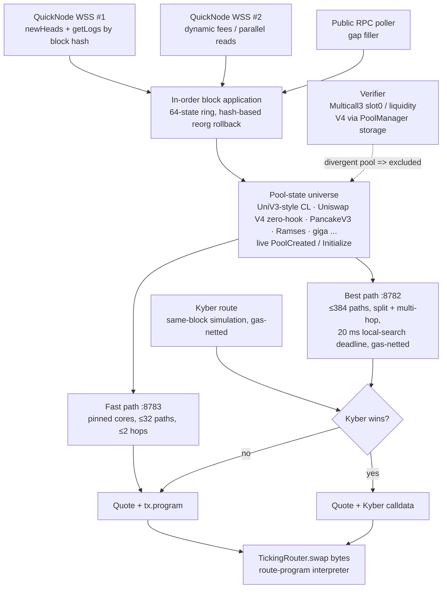
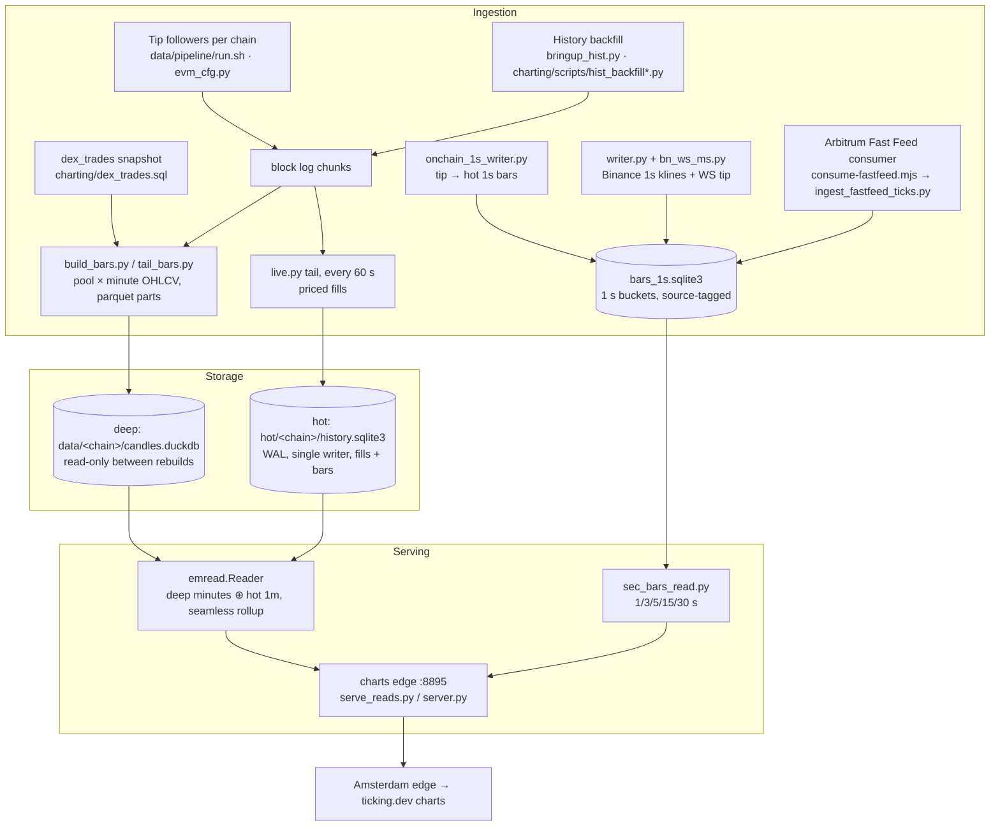

# ticking

Ticking is a spot trading terminal for **Robinhood Chain (chain id 4663)**. Under the hood it is a DEX
aggregator with its own routing engine and its own router contract, plus an on-chain data and charting
backend.

- Ticking routes only through **existing DEX pools** on Robinhood Chain. It runs no AMM, market maker or RFQ of its own.
- The engine quotes from its own copy of pool state, kept current block by block.
- **KyberSwap is a fallback only.** Ticking uses it when Kyber's route, simulated at the same block and
  netted for gas, returns more than Ticking's own route.
- Trades settle through **TickingRouter**, deployed on Robinhood Chain mainnet at
  [`0x9745fF56A6FC085B3e70A7509cd49Ab6b97dCBD6`](https://robinhoodchain.blockscout.com/address/0x9745fF56A6FC085B3e70A7509cd49Ab6b97dCBD6)
  (deploy tx and constructor args are in [`contracts/DEPLOYED.md`](contracts/DEPLOYED.md)).
- USDG and USDC are both supported as quote assets.

> The contract has **not** had an external audit (owner's decision). The evidence we do have is listed below.

---

## 1. Aggregator architecture



### Engine (`aggregator/`, Rust)

- **State feed.** QuickNode WSS `newHeads` is the trigger. For each head, logs are fetched by block hash
  on the same socket, and dynamic fees are read on a second socket in parallel. A public-RPC poller fills
  any gaps. `getLogs` by hash is the source of truth because pushed logs can arrive after the next head.
- **Ordering and reorgs.** Blocks are applied strictly in order. A ring of 64 states allows hash-based rollback on a reorg.
- **Verification.** A verifier keeps re-reading pools on chain: Multicall3 for `slot0` and `liquidity`, and
  `PoolManager` storage for V4. A pool that diverges is marked dirty and removed from routing until it is reconciled.
- **Excluded venues.** Hooked Uniswap V4 pools and Pancake Infinity CL are not routed. Their hook logic is not modelled exactly.
- **Two quote servers.** The fast path (`:8783`) is for memecoins, where speed matters more than the last
  basis point. The best path (`:8782`) is for stocks, RWAs and USDG, where price matters.
- **Code.** `src/bin/engine2.rs` is the production engine, `src/router.rs` is routing and `src/lib.rs` is pool math.
  `harness/` holds the Python oracles, fuzzers, Kyber simulation and router proofs. `service/` holds the soak and load clients.

### Router contract (`contracts/`, Solidity 0.8.26)

- **One entry point.** `swap(bytes)` runs a bit-packed route program through a small interpreter loop.
- **No owner, no upgrades.** The contract has no storage, no owner, no pause and no proxy. Its 13 dependency
  addresses are immutables.
- **Transient storage** (EIP-1153) holds the reentrancy lock and the expected-callback authorization.
- **Pool authentication.** Every pool is checked against its factory, or against PoolManager / Vault for
  V4-style venues, before a callback is trusted.
- **Payment.** Tokens are paid just in time from the user inside the pool callback. Each hop is exact-in, and
  a token-identity rule links each hop's output token to the next hop's input token.
- **Kyber sandbox.** Only 2 Kyber selectors are allowed. The router grants an exact approval and requires it
  to read 0 afterwards. Output is measured as a balance delta, never trusted from return data.
- **Assembly** is used only for program reads, ERC20 calls and transient slots.
- **Docs.** See [`ARCHITECTURE.md`](contracts/ARCHITECTURE.md), [`INVARIANTS.md`](contracts/INVARIANTS.md) and [`SECURITY.md`](contracts/SECURITY.md).

**Contract evidence** (reproduce with `contracts/ci.sh`)

| Check | Result |
|---|---|
| Foundry unit, fork, fuzz and invariant suites | pass (fork tests need an RPC in env) |
| Halmos symbolic proofs | 5 properties proven |
| Slither | 0 High, 0 Medium |
| Mutation testing (`script/mutate.py`) | 152 / 153 mutants killed (`mutation_report.json`) |
| Build | solc 0.8.26, via-IR, optimizer 200 runs, `cancun` |
| Source verification | standard JSON input in `contracts/verify/` |

### Measured results

Final gate run "soak6", 2026-10-25 04:04–04:30 SGT, about 25 minutes under load on the London server. The full table is in [`aggregator/ENGINE.md`](aggregator/ENGINE.md).

| Metric | Result |
|---|---|
| Quotes on the latest block (lag 0) | **96.1%** (295,516 / 307,404); lag ≤ 1 block: 99.99% |
| Verifier | 610,038 pool checks, **0 diverged** |
| Quote equals execution: `eth_call` of the deployed router's `swap(bytes)` | **63 / 63 exact to the wei** (1 route not executable, see below) |
| Fast path compute time (engine, all requests) | p50 25 µs, p99 1.34 ms, p999 3.97 ms |
| Fast path, memecoin routes as measured by the soak client | p50 0.34 ms, p99 2.28 ms. **Misses** the 2 ms target on this sample |
| Best path compute time | p50 6.0 ms, p99 27.9 ms |
| Kyber comparison on stock routes (same block, gas-netted) | Ticking wins 10 / 21. Every loss was to signed RFQ or private-MM liquidity that Ticking does not use |

### Known limitations (honest list)

- **USDC liquidity is poor.** The canonical bridged USDC on Robinhood Chain has very little supply. Its only
  liquid USDC/USDG pool is a V4 pool with a 92% fee. Quotes are exact but bad for the user.
- **One route type cannot be executed yet.** Some "best" routes, for example USDG→WETH, pass through a
  native-ETH V4 hop that the v1 router does not execute.
- **Restart catch-up can mis-sync pools.** One large catch-up after a restart left 2 V4 pools divergent.
  The verifier caught and excluded both, so they were never quoted. The fix is to fetch the catch-up in
  smaller chunks, and it is pending.
- **Excluded venues.** Hooked V4 pools and Pancake Infinity are excluded, so liquidity there is unused.

### Public API

The API base is `https://api.ticking.dev/api/router/`. It is rate-limited to 20 requests/s per IP, CORS is
open, and only GET is allowed. The full spec is [`docs/FRONTEND_API.md`](docs/FRONTEND_API.md).

| Endpoint | Purpose |
|---|---|
| `GET /api/router/health` | 200 when the engine is at most 3 blocks behind, otherwise 503 |
| `GET /api/router/quote` | best route (split, multi-hop, gas-netted), with a ready-to-send `tx` |
| `GET /api/router/fast` | fast route for memecoins, with a ready-to-send `tx` |
| `GET /api/router/pool_quote` | exact simulation of a single pool (for debugging) |

---

## 2. Data architecture

The data and charting services run on the **London bare-metal server**, which is the compute and data
centre. The **Amsterdam** server handles frontend delivery and the light public API. Amsterdam reaches
London through read-only loopback tunnels.



### Ingestion

- **On-chain swaps.** Per-chain tip followers (`data/pipeline/run.sh`, configured by `evm_cfg.py`) write
  block log chunks. History gaps are filled from archived chunks by the backfill scripts.
- **Minute bars.** `build_bars.py` and `tail_bars.py` turn swaps into pool × minute OHLCV Parquet parts.
  - A swap is priced only when one side is an anchor: a USD stable, ETH/WETH (including V4 native ETH), WBTC/cbBTC or ARB.
  - ETH, BTC and ARB are converted to USD using a per-minute composite of their own stable-quoted pools.
- **Token price composite.** The per-minute token composite is `em_pool_reference_v2`.
  - The reference price is the close of the most established pool printing that minute.
  - Other pools are admitted only within ±5% of the reference.
  - Wicks are clamped, and dust or outlier minutes are dropped. The exact rules are in `charting/README.md`.
- **1-second bars.**
  - `writer.py` mirrors Binance 1 s klines for mapped majors.
  - `bn_ws_ms.py` adds the Binance WebSocket tip.
  - `onchain_1s_writer.py` writes on-chain 1 s bars from tip to hot for admitted tokens.
  - `ingest_fastfeed_ticks.py` paints Arbitrum Fast Feed ticks into the open second only. It never
    overwrites a closed Binance second, rejects ticks outside a 5% wick band and fails soft when the feed is stale.

### Storage and retention

| Tier | Store | Writer | Retention |
|---|---|---|---|
| Deep | `data/<chain>/candles.duckdb` (markets, token_bars, pool_bars, anchor_px, info) | `build_db.py` rebuild, then a file swap | full history, immutable between rebuilds |
| Hot | `hot/<chain>/history.sqlite3`: `fills`, `bars` (60/300/3600 s), `fill_meta`, `pools`, `state` | `live.py`, the only writer (WAL, readers use `mode=ro`) | `HOT_DAYS = 14` in `hotstore.py` |
| 1 s | `sec-bars/out/bars_1s.sqlite3` | `writer.py`, `onchain_1s_writer.py`, fast-feed ingest | Binance mirror 2 h, on-chain 7 days (configurable through env) |
| Block-time map | `data/block_minutes_<chain>.parquet` | `build_block_minutes.py`, `block_minutes_live.py` | full |

- `state.data_version` is bumped in the same transaction as every write, so readers can detect changes cheaply.
- The `fills` and `bars` tables use the same DDL as the Ticking chart engine (`observed_projector.hpp`).
  A fill's identity is `0x<tx>:<log>`, and its order string is `block:tx:log:identity`.

### Serving

- **Charts edge `:8895`** (`serve_reads.py` / `server.py`, read-only) serves `/api/public/engine/candles`,
  `/api/public/stream/candles` and `/api/public/markets[/<id>]`.
  - `emread.Reader` joins deep minutes (up to `data_until_ms`) with hot 1-minute bars after that point, so
    minute candles have no gap at the seam.
  - Every larger interval is rolled up from those minutes.
- `interval=1s` and the 3/5/15/30 s intervals are read from the 1 s store by `sec_bars_read.py`.
- Heavy analytics run in a separate worker (`worker.py`), so chart reads are never blocked by analytics.

---

## 3. Repository map

| Path | Contents |
|---|---|
| `contracts/` | TickingRouter (`src/`), Foundry tests (`test/`: unit, fork, invariant, Halmos), deploy script, mutation runner, verify input, docs |
| `aggregator/` | Rust routing engine (`src/`), Python harness (`harness/`), soak and load clients (`service/`), `ENGINE.md`, `ci_gates.sh` |
| `data/` | Robinhood/Arbitrum data pipeline: tip followers and backfill (`pipeline/`), 1 s bars (`sec-bars/`), Arbitrum Fast Feed (`fastfeed/`, `asset-feed/`) |
| `charting/` | Chart backend (charts edge `:8895`): bar building, deep and hot stores, readers, analytics, backfill scripts |
| `docs/FRONTEND_API.md` | Public router API spec |
| `engine/`, `packages/`, `terminal/`, `api/`, … | Earlier source release: Solana/global collectors, chart SDK, Pro terminal (see [`docs/TERMINAL_RELEASE.md`](docs/TERMINAL_RELEASE.md)) |

## Build and test

```bash
# contracts
cd contracts
forge install foundry-rs/forge-std --no-git   # or: git clone https://github.com/foundry-rs/forge-std lib/forge-std
forge build
forge test --no-match-path 'test/Fork*'        # fork tests: export RH_RPC=<your RPC> first
./ci.sh                                        # full gate: tests, Slither, Halmos, mutation

# engine
cd aggregator
cargo build --release
./ci_gates.sh                                  # needs RPC endpoints in env
```

The Python parts of `data/` and `charting/` use Python 3 with `duckdb`, `pyarrow` and the standard
library's `sqlite3`. They expect server paths under `/srv/skew/…` and are published for review, not as a
turnkey install.

## Security notes

- No RPC URLs with keys, private keys, SAS tokens or credentials are in this repository. Scripts read them from
  environment variables or root-only files on the server (for example `DEPLOYER_PK`, Blob SAS and the
  Fast Feed key file).
- No databases, Parquet data, logs or captured production data are included.
- Report vulnerabilities as described in [`SECURITY.md`](SECURITY.md) and [`contracts/SECURITY.md`](contracts/SECURITY.md).

## License

See [`NOTICE.md`](NOTICE.md). Source is public for review. No general redistribution licence is granted
unless a package says otherwise.
