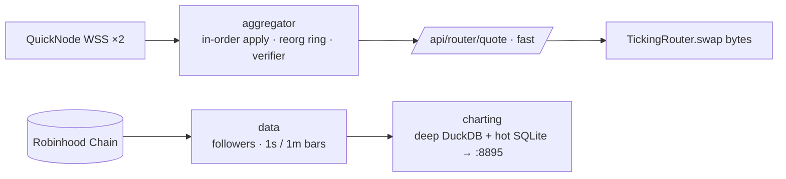

# ticking

[](https://github.com/skew-labs/ticking/actions/workflows/contracts.yml)
[](https://github.com/skew-labs/ticking/actions/workflows/aggregator.yml)
[](https://github.com/skew-labs/ticking/actions/workflows/python.yml)

Spot trading on **Robinhood Chain (4663)**. This repository holds the four pieces that power it:

| Component | Path | What it is |
|---|---|---|
| Router contract | [`contracts/`](contracts) | `TickingRouter`, an ownerless, immutable route-program interpreter, deployed at [`0x9745fF56A6FC085B3e70A7509cd49Ab6b97dCBD6`](https://robinhoodchain.blockscout.com/address/0x9745fF56A6FC085B3e70A7509cd49Ab6b97dCBD6) |
| Routing engine | [`aggregator/`](aggregator) | A Rust engine that tracks pool state block by block and serves exact quotes with a ready-to-send `tx` |
| Data pipeline | [`data/`](data) | Tip followers, backfill, and 1-second and 1-minute bar writers |
| Chart backend | [`charting/`](charting) | Deep and hot candle stores, plus the read API behind the charts |

Ticking is a DEX aggregator with its own routing engine. It routes only through existing on-chain pools.
KyberSwap is used as a fallback only when its same-block, gas-netted route returns more.

## How it fits together



- [docs/ARCHITECTURE.md](docs/ARCHITECTURE.md): the engine, the router contract and measured results
- [docs/DATA.md](docs/DATA.md): ingestion, storage tiers and serving
- [docs/FRONTEND_API.md](docs/FRONTEND_API.md): the public router API
- [docs/ADR/](docs/ADR): architecture decision records

## Measured results (final gate run, 2026-10-25)

| | |
|---|---|
| Quotes on the latest block | 96.1% (lag ≤ 1 block: 99.99%) |
| Verifier pool checks | 610,038, with 0 diverged |
| Deployed router: `eth_call` result equals the quote | 63 / 63, exact to the wei |
| Fast-path compute time | p50 25 µs, p99 1.34 ms |

## Quick start

```bash
make build      # forge build + cargo build --release
make test       # forge unit/invariant tests + cargo test
make lint       # forge fmt --check, cargo fmt --check, ruff
```

Toolchains: [Foundry](https://getfoundry.sh), stable Rust, and Python 3 with `ruff`. Fork tests read `RH_RPC`
(by default the public Robinhood RPC). Run them with `make test-fork`.

## Contributing and security

See [CONTRIBUTING.md](CONTRIBUTING.md) and [SECURITY.md](SECURITY.md). Licensing terms are in [NOTICE.md](NOTICE.md).
