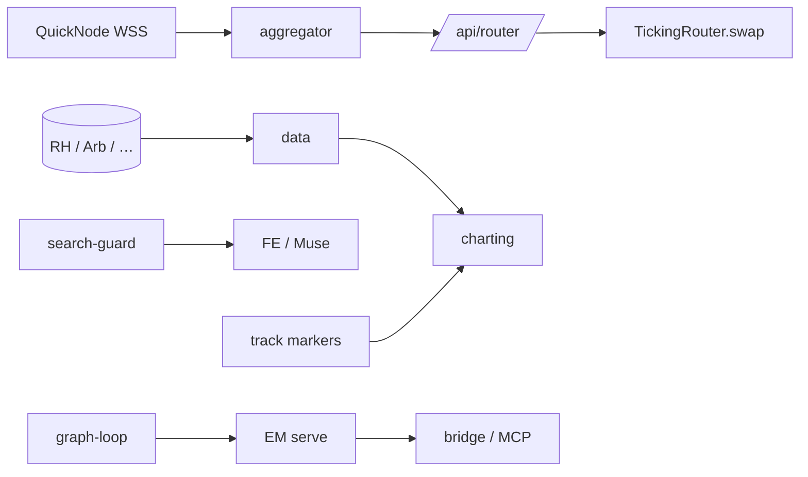

# ticking

[](https://github.com/skew-labs/ticking/actions/workflows/contracts.yml)
[](https://github.com/skew-labs/ticking/actions/workflows/aggregator.yml)
[](https://github.com/skew-labs/ticking/actions/workflows/python.yml)
[](https://github.com/skew-labs/ticking/actions/workflows/agents.yml)

Robinhood Chain (4663) spot stack: DEX aggregator, on-chain router, market data, charts, and the agent system that sits on top.

| Component | Path | What it is |
|---|---|---|
| Router contract | [`contracts/`](contracts) | `TickingRouter` — ownerless route-program interpreter. Live v1: [`0x9745…CBD6`](https://robinhoodchain.blockscout.com/address/0x9745fF56A6FC085B3e70A7509cd49Ab6b97dCBD6). Tree holds current (v2) source with 0.05% fee + native ETH V4. |
| Routing engine | [`aggregator/`](aggregator) | Rust engine: block-ordered state, reorg ring, verifier; `/quote` and `/fast` with ready-to-send `tx` |
| Data pipeline | [`data/`](data) | Tip followers, backfill, 1s / 1m bar writers |
| Chart backend | [`charting/`](charting) | Deep + hot candle stores and the charts read API |
| Search | [`search/`](search) | Search-guard resolve, investigate search, suggest overlay |
| Research | [`research/`](research) | Refresh SQL/Python, labels, extractors |
| Economic Machine | [`em/`](em) | EM v2 core / serve / ops (source; no ledger blobs) |
| Graph loop | [`graph/`](graph) | C++ graph-loop engine (`glserve`) |
| Agents | [`agents/`](agents) | Muse, track, bridge, MCP, context, realtime |

Ticking routes only through existing on-chain pools. KyberSwap is a fallback when its same-block, gas-netted route wins.

## How it fits together



- [docs/ARCHITECTURE.md](docs/ARCHITECTURE.md) — router + engine
- [docs/ARCHITECTURE-AGENTS.md](docs/ARCHITECTURE-AGENTS.md) — search, research, EM, graph-loop, Muse/track
- [docs/DATA.md](docs/DATA.md) — ingestion and storage
- [docs/FRONTEND_API.md](docs/FRONTEND_API.md) — public router API (LIVE)
- [docs/ADR/](docs/ADR) — decision records

## Measured results (final gate run, 2026-10-25)

| | |
|---|---|
| Quotes on the latest block | 96.1% (lag ≤ 1 block: 99.99%) |
| Verifier pool checks | 610,038, with 0 diverged |
| Deployed router: `eth_call` equals quote | 63 / 63, exact to the wei |
| Fast-path compute | p50 25 µs, p99 1.34 ms |

## Quick start

```bash
make build      # forge build + cargo build --release
make test       # forge unit/invariant tests + cargo test
make lint       # forge fmt --check, cargo fmt --check, ruff
make agents-check  # byte-compile agent / search / research Python
```

Toolchains: [Foundry](https://getfoundry.sh), stable Rust, Python 3 + `ruff`. Fork tests need `RH_RPC` (`make test-fork`).

## Contributing and security

See [CONTRIBUTING.md](CONTRIBUTING.md) and [SECURITY.md](SECURITY.md). Licensing: [NOTICE.md](NOTICE.md).
