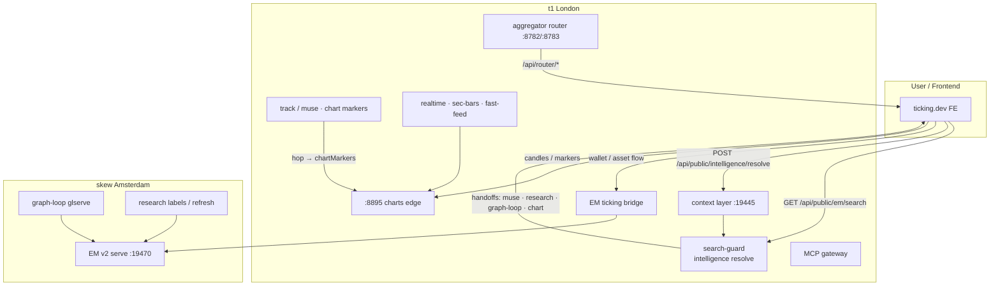
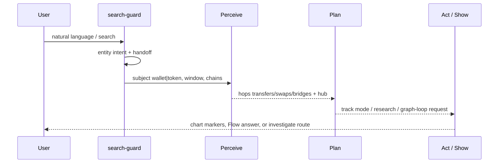
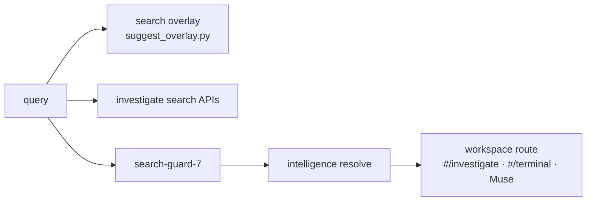
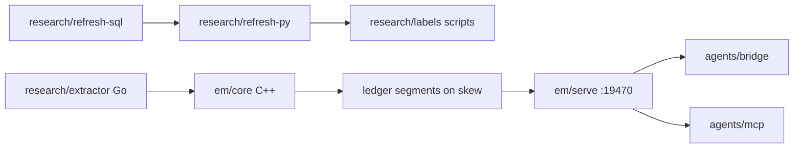
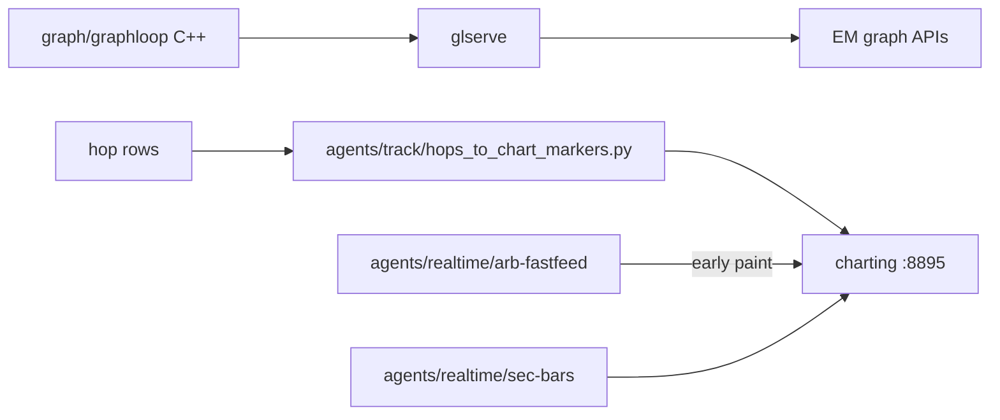

# Agent system architecture

How search, research, the Economic Machine (EM), the graph loop, and the latest agents fit together.
Runtime hosts: **t1 (London)** for tip/hot charts, EM serve, search-guard, and the router engine; **skew / Amsterdam edge** for large EM ledger and compact DBs.

This document describes the code in `search/`, `research/`, `em/`, `graph/`, and `agents/`.

## Big picture

## Perceive → Plan → Act

The wallet-hub / Muse path uses a three-step contract (see historical `PERCEIVE_API` notes; product surface is chart-centric).

| Step | Code | Role |
|---|---|---|
| Perceive | `agents/track/`, hop tables via EM serve | Load transfer / swap / bridge hops for a subject and window |
| Plan | `search/search-guard/` (`planner_intent.py`, `assistant_task_flow.py`) | Choose Muse / research / graph-loop / chart-assist handoff |
| Act / Show | `agents/muse/`, `agents/track/muse_track_mode.py`, `hops_to_chart_markers.py` | Paint Flow answers and chart markers; open investigate routes |

## Search → workspace

| Path | Directory | Notes |
|---|---|---|
| Typeahead / EM search | `search/overlay/`, public `/api/public/em/search` | Suggest + protocol prefetch |
| Investigate search | `search/investigate/` | Entity / wallet PnL / directory APIs |
| Search-guard | `search/search-guard/` | Versioned resolve pipeline; handoffs `muse-agent`, `research-assist`, `graph-loop`, `chart-assist` |
| Context | `agents/context/` | nginx → context → intelligence |

## Research ↔ Economic Machine

| Path | Directory | Notes |
|---|---|---|
| EM core / serve | `em/core`, `em/serve`, `em/graph-src` | C++ Economic Machine v2: compact stores, HTTP serve |
| Ops / verify | `em/ops`, `em/verify`, `em/bench` | Publish, fetch, compare helpers (no ledger blobs in git) |
| Refresh pipeline | `research/refresh-py`, `research/refresh-sql` | SQL stages + Python refresh / galaxy / narratives |
| Labels | `research/labels` | Seed / registry builders (parquet outputs not committed) |
| Extractor | `research/extractor` | Go RPC / trace extractors (source only) |
| Bridge | `agents/bridge` | Public wallet-flow / asset-flow facing FE |
| MCP | `agents/mcp` | Tool gateway + EM v1 adapter |

Public EM surfaces used by the product include `/api/public/em/v1/*` (tunneled to serve) and `/api/public/em/wallet-flow/*`, `/api/public/em/asset-flow/*` (bridge).

## Graph loop ↔ charts

| Path | Directory | Notes |
|---|---|---|
| Graph-loop engine | `graph/graphloop` | C++ build / serve / export (`glserve`, `glbuild`, …) |
| Mapping graphloop | `graph/mapping-graphloop` | Smaller mapping-side helpers |
| Track autonomy | `agents/track` | Muse track mode, tip/hot fills, hop→markers, serve_track |
| Realtime | `agents/realtime` | 1s bars writers, Arb fast-feed consumer (early paint only; tip/hot remains SoT) |

## Latest agent stack (Muse / track)

| Piece | Directory | Role |
|---|---|---|
| Muse FE helpers | `agents/muse/fe` | Investigate / assistant / wallet-flow chart / agent tools (JS) |
| Muse prepare | `agents/muse/*.py` | Release packaging helpers |
| Track server | `agents/track/serve_track.py` | Chart-only tracker backend |
| Autonomy | `agents/track/em_track_autonomy.py` | Perceive→Plan→Act track loop |

## Ports and APIs (as found in code / wiring)

| Port / path | Component |
|---|---|
| `:8782` / `:8783` | Aggregator best / fast quote (also under `aggregator/`) |
| `:8895` | Charts edge |
| `:19470` | EM v2 serve (`/healthz`, `/v1/search`, `/v1/address/…`) |
| `:19445` / `:19444` | Context → intelligence |
| `:19451` | Holdings / flow proxy (bridge) |
| `:19480` | Tracker chart-only (when enabled) |
| `https://api.ticking.dev/api/router/*` | Public router |
| `https://ticking.dev/api/public/em/*` | Public EM / flow / search |

Exact bind addresses are deployment-local; this repo ships the source and contracts, not live credentials.

## What is not in git

Databases, ledger segments, parquet dumps, `node_modules`, `.venv`, `.env`, API keys, logs, and STATUS dumps with private host detail are excluded. Rebuild data on the servers; compile C++/Go binaries from the sources here.
