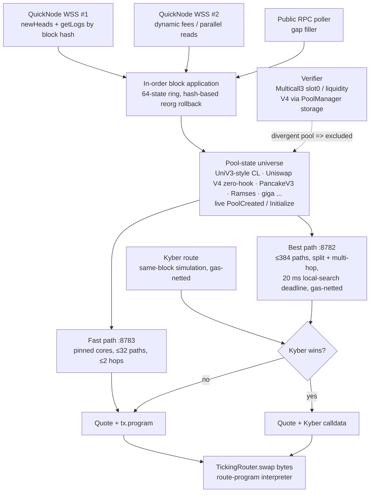

# Aggregator architecture

### Engine (`aggregator/`, Rust)

- **State feed.** QuickNode WSS `newHeads` is the trigger. For each head, logs are fetched by block hash
  on the same socket, and dynamic fees are read on a second socket in parallel. A public-RPC poller fills
  any gaps. `getLogs` by hash is the source of truth because pushed logs can arrive after the next head.
- **Ordering and reorgs.** Blocks are applied strictly in order. A ring of 64 states allows hash-based rollback on a reorg.
- **Verification.** A verifier keeps re-reading pools on chain: Multicall3 for `slot0` and `liquidity`, and
  `PoolManager` storage for V4. A pool that diverges is marked dirty and removed from routing until it is reconciled.
- **Venues routed.** UniV3-style CL pools (Uniswap V3, Sushi, giga, Ramses, up) and zero-hook Uniswap V4 pools.
- **Two quote servers.** The fast path (`:8783`) is for memecoins, where speed matters more than the last
  basis point. The best path (`:8782`) is for stocks, RWAs and USDG, where price matters.
- **Code.** `src/bin/engine2.rs` is the production engine, `src/router.rs` is routing and `src/lib.rs` is pool math.
  `harness/` holds the Python oracles, fuzzers, Kyber simulation and router proofs. `service/` holds the soak and load clients.

### Router contract (`contracts/`, Solidity 0.8.26)

- **One entry point.** `swap(bytes)` runs a bit-packed route program through a small interpreter loop.
- **No owner, no upgrades.** The contract has no storage, no owner, no pause and no proxy. Its 13 dependency
  addresses are immutables.
- **Transient storage** (EIP-1153) holds the reentrancy lock and the expected-callback authorization.
- **Pool authentication.** Every pool is checked against its factory, or against PoolManager / Vault for
  V4-style venues, before a callback is trusted.
- **Payment.** Tokens are paid just in time from the user inside the pool callback. Each hop is exact-in, and
  a token-identity rule links each hop's output token to the next hop's input token.
- **Kyber sandbox.** Only 2 Kyber selectors are allowed. The router grants an exact approval and requires it
  to read 0 afterwards. Output is measured as a balance delta, never trusted from return data.
- **Assembly** is used only for program reads, ERC20 calls and transient slots.
- **Docs.** See [`ARCHITECTURE.md`](contracts/ARCHITECTURE.md), [`INVARIANTS.md`](contracts/INVARIANTS.md) and [`SECURITY.md`](contracts/SECURITY.md).

**Contract evidence** (reproduce with `contracts/ci.sh`)

| Check | Result |
|||
| Foundry unit, fork, fuzz and invariant suites | pass (fork tests need an RPC in env) |
| Halmos symbolic proofs | 5 properties proven |
| Slither | 0 High, 0 Medium |
| Mutation testing (`script/mutate.py`) | 152 / 153 mutants killed (`mutation_report.json`) |
| Build | solc 0.8.26, via-IR, optimizer 200 runs, `cancun` |
| Source verification | standard JSON input in `contracts/verify/` |

### Measured results

Final gate run "soak6", 2026-10-25 04:04–04:30 SGT, about 25 minutes under load on the London server. The full table is in [`aggregator/ENGINE.md`](aggregator/ENGINE.md).

| Metric | Result |
|||
| Quotes on the latest block (lag 0) | **96.1%** (295,516 / 307,404); lag ≤ 1 block: 99.99% |
| Verifier | 610,038 pool checks, **0 diverged** |
| Quote equals execution: `eth_call` of the deployed router's `swap(bytes)` | **63 / 63 exact to the wei** |
| Fast path compute time (engine, all requests) | p50 25 µs, p99 1.34 ms, p999 3.97 ms |
| Best path compute time | p50 6.0 ms, p99 27.9 ms |

### Public API

The API base is `https://api.ticking.dev/api/router/`. It is rate-limited to 20 requests/s per IP, CORS is
open, and only GET is allowed. The full spec is [`docs/FRONTEND_API.md`](docs/FRONTEND_API.md).

| Endpoint | Purpose |
|||
| `GET /api/router/health` | 200 when the engine is at most 3 blocks behind, otherwise 503 |
| `GET /api/router/quote` | best route (split, multi-hop, gas-netted), with a ready-to-send `tx` |
| `GET /api/router/fast` | fast route for memecoins, with a ready-to-send `tx` |
| `GET /api/router/pool_quote` | exact simulation of a single pool (for debugging) |
