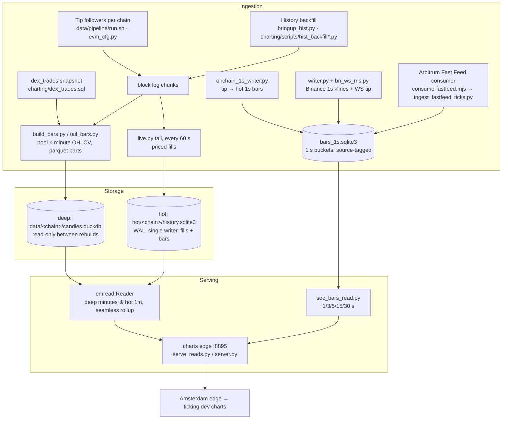

# Data architecture

The data and charting services run on the **London bare-metal server**, which is the compute and data
centre. The **Amsterdam** server handles frontend delivery and the light public API. Amsterdam reaches
London through read-only loopback tunnels.

### Ingestion

- **On-chain swaps.** Per-chain tip followers (`data/pipeline/run.sh`, configured by `evm_cfg.py`) write
  block log chunks. History gaps are filled from archived chunks by the backfill scripts.
- **Minute bars.** `build_bars.py` and `tail_bars.py` turn swaps into pool × minute OHLCV Parquet parts.
  - A swap is priced only when one side is an anchor: a USD stable, ETH/WETH (including V4 native ETH), WBTC/cbBTC or ARB.
  - ETH, BTC and ARB are converted to USD using a per-minute composite of their own stable-quoted pools.
- **Token price composite.** The per-minute token composite is `em_pool_reference_v2`.
  - The reference price is the close of the most established pool printing that minute.
  - Other pools are admitted only within ±5% of the reference.
  - Wicks are clamped, and dust or outlier minutes are dropped. The exact rules are in `charting/README.md`.
- **1-second bars.**
  - `writer.py` mirrors Binance 1 s klines for mapped majors.
  - `bn_ws_ms.py` adds the Binance WebSocket tip.
  - `onchain_1s_writer.py` writes on-chain 1 s bars from tip to hot for admitted tokens.
  - `ingest_fastfeed_ticks.py` paints Arbitrum Fast Feed ticks into the open second only. It never
    overwrites a closed Binance second, rejects ticks outside a 5% wick band and fails soft when the feed is stale.

### Storage and retention

| Tier | Store | Writer | Retention |
|||||
| Deep | `data/<chain>/candles.duckdb` (markets, token_bars, pool_bars, anchor_px, info) | `build_db.py` rebuild, then a file swap | full history, immutable between rebuilds |
| Hot | `hot/<chain>/history.sqlite3`: `fills`, `bars` (60/300/3600 s), `fill_meta`, `pools`, `state` | `live.py`, the only writer (WAL, readers use `mode=ro`) | `HOT_DAYS = 14` in `hotstore.py` |
| 1 s | `sec-bars/out/bars_1s.sqlite3` | `writer.py`, `onchain_1s_writer.py`, fast-feed ingest | Binance mirror 2 h, on-chain 7 days (configurable through env) |
| Block-time map | `data/block_minutes_<chain>.parquet` | `build_block_minutes.py`, `block_minutes_live.py` | full |

- `state.data_version` is bumped in the same transaction as every write, so readers can detect changes cheaply.
- The `fills` and `bars` tables use the same DDL as the Ticking chart engine (`observed_projector.hpp`).
  A fill's identity is `0x<tx>:<log>`, and its order string is `block:tx:log:identity`.

### Serving

- **Charts edge `:8895`** (`serve_reads.py` / `server.py`, read-only) serves `/api/public/engine/candles`,
  `/api/public/stream/candles` and `/api/public/markets[/<id>]`.
  - `emread.Reader` joins deep minutes (up to `data_until_ms`) with hot 1-minute bars after that point, so
    minute candles have no gap at the seam.
  - Every larger interval is rolled up from those minutes.
- `interval=1s` and the 3/5/15/30 s intervals are read from the 1 s store by `sec_bars_read.py`.
- Heavy analytics run in a separate worker (`worker.py`), so chart reads are never blocked by analytics.
